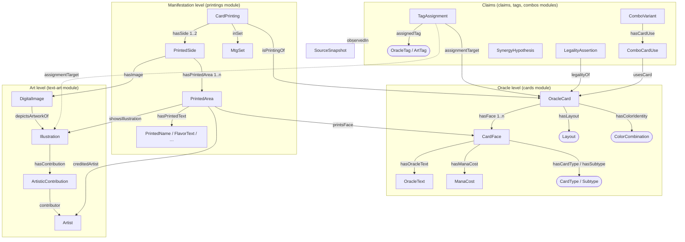
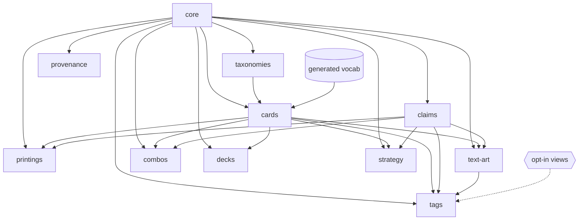

# Conceptual model

SMTG keeps apart levels that card databases usually flatten into one JSON object. The diagram
shows four of them: abstract game identity (Oracle level), published manifestations, visual works
with their representations, and claims. Claims and provenance cut across all the others.

## The levels, with one example each

| Level | Class | Example (from the fixtures) |
|---|---|---|
| Abstract identity | `OracleCard` | [[Bonecrusher Giant // Stomp]] (one Oracle ID) |
| Conceptual face | `CardFace` | face 0 *Bonecrusher Giant* (Creature — Giant), face 1 *Stomp* (Instant — Adventure) |
| Printing | `CardPrinting` | one Scryfall card ID: set, collector number, language |
| Printed side | `PrintedSide` | front or back of one printing: its images, and its printed areas |
| Printed area | `PrintedArea` | one face as printed on a side: printed name, text and flavor text, illustration, credited artist, watermark |
| Text expression | `OracleText`, `PrintedRulesText`, `FlavorText`, `PrintedName`, `FlavorName` … | the Italian *Fulmine* printed name of [[Lightning Bolt\|M10\|146\|it]] |
| Visual work | `Illustration` | one `illustration_id`, shared by several printings |
| Representation | `DigitalImage` | the `art_crop` URL of a printed face |
| Claim | `TagAssignment`, `LegalityAssertion`, `PriceObservation`, `ComboVariant`, `SynergyHypothesis` … | Tagger: *burn any* applies to [[Lightning Bolt]] (very_strong), observed 2026-11-03 |
| Provenance | `SourceSnapshot`, activities, agents | Scryfall `oracle_tags` snapshot, SHA-256 23d94bab… |

## One card, many levels

[[!Lightning Bolt|LEA|161]] [[!Lightning Bolt|M10|146|it]]

Both images are printings of the same Oracle card, [[Lightning Bolt]]: different sets, languages,
illustrations and printed text (*Il Fulmine infligge 3 danni a una creatura o a un giocatore
bersaglio.* versus today's Oracle wording *deals 3 damage to any target*).

## Three separations Scryfall's `layout` flattens

1. **Face configuration** (`smtg:FaceConfiguration`): single face, several parts on one side, faces
   on opposite sides, or opposite sides carrying separate Oracle objects.
2. **Layout convention** (`smtg:Layout`): the source code, kept verbatim and open (new codes such as
   `prepare` become new concepts).
3. **Modal semantics**: "modal double-faced card" is a layout; "choose one —" is an ability. v1
   classifies only the former.

[[!Bonecrusher Giant // Stomp]] [[!Agadeem's Awakening // Agadeem, the Undercrypt]] [[!Akki Lavarunner // Tok-Tok, Volcano Born]]

Two faces on one side (an adventure), two faces on two sides (a modal double-faced card), and two
faces on one side with one printed upside down (a flip card): three different configurations that a
single "two faces" count would hide. Each layout concept states its face configuration and object kind. The *Layout matrix* page in the
documentation shows them side by side, with the OWL class that the layout defines.

## OWL, SKOS and SHACL each do one job

- **OWL** expresses what is necessarily true of the entity types: disjointness between levels,
  functional layout, class definitions by layout value, ranges. HermiT checks consistency.
- **SKOS** holds the controlled vocabularies and the source tag schemes. They are open and
  extensible, with no class-membership entailments.
- **SHACL** checks that the instance graphs the pipeline produces are complete and well-formed
  (closed world). A violation means a data error, not a fact about cards.

## Module map

